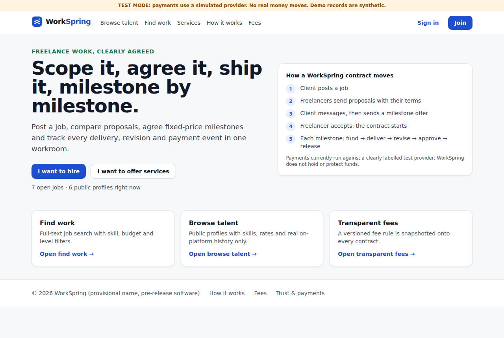
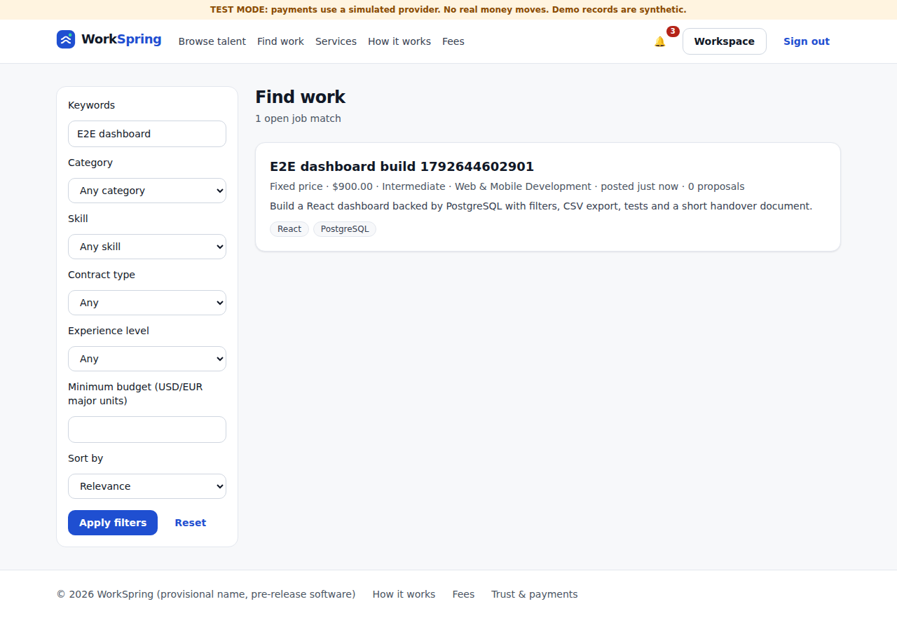
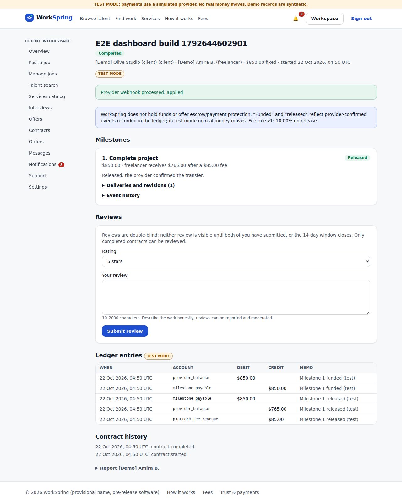
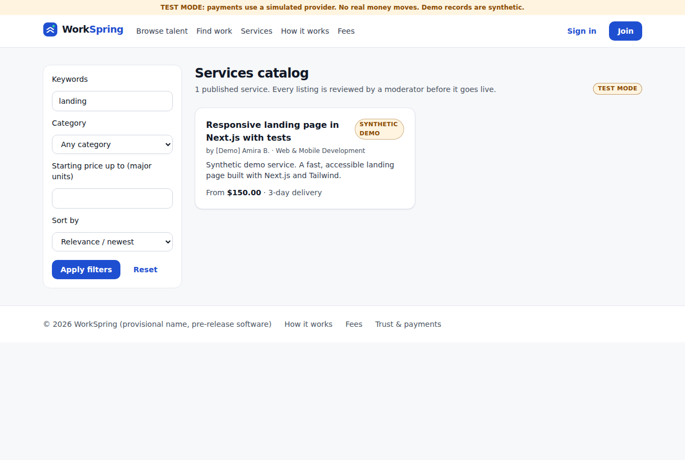
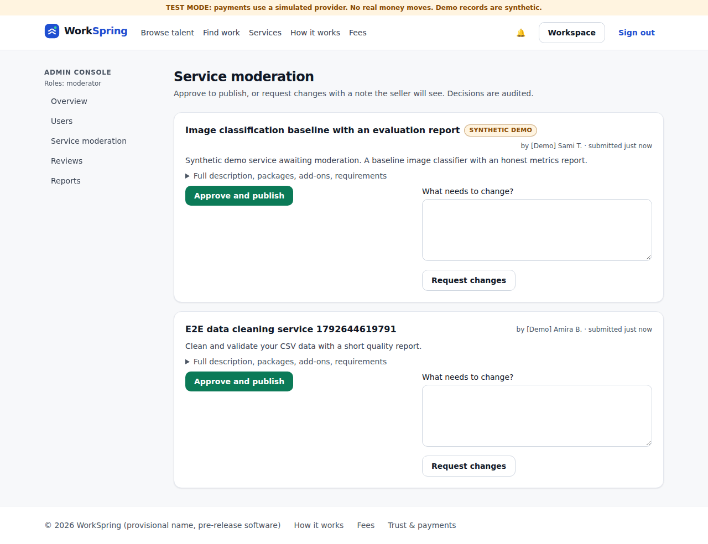
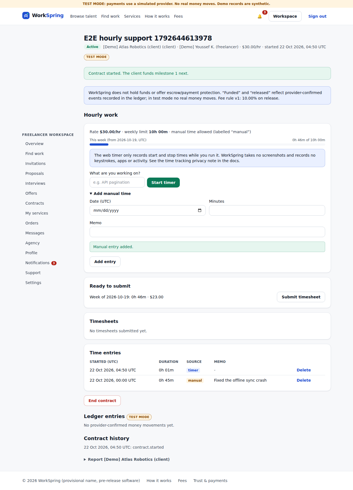

# WorkSpring

[](https://github.com/bileldh-ing/workspring/actions/workflows/ci.yml)
[](https://github.com/bileldh-ing/workspring/actions/workflows/mobile.yml)
[](https://github.com/bileldh-ing/workspring/actions/workflows/security.yml)

WorkSpring is an original two-sided freelance marketplace. Clients post fixed-price or hourly jobs, or buy packaged services. Freelancers apply, track time, sell services and get paid through a payment provider. The name is provisional: trademark and domain checks are still needed before any commercial use.

**Status: v1.0.0, pre-production.** Every feature below runs on a real PostgreSQL database, with server-side authorization, state machines, event history and tests. Payments run in **TEST MODE only**: a simulated provider sends HMAC-signed webhooks and **no real money moves**. WorkSpring does **not** offer escrow or payment protection, and nothing is publicly hosted yet.

WorkSpring is not an Upwork clone and does not claim to match it. [`docs/REFERENCE_PRODUCT_AUDIT.md`](docs/REFERENCE_PRODUCT_AUDIT.md) lists, with sources, which publicly documented workflows were adapted and which were left out.

## Features

| Area | What works | Tests |
|---|---|---|
| Accounts | Email + password (Argon2id), email verification, password reset, DB sessions, one identity that can both hire and work | IT, HTTP |
| Profiles & search | Freelancer profiles from a skills taxonomy; Postgres full-text search for jobs, talent and services, with filters, sort and pagination | IT, e2e |
| Jobs & proposals | Draft → open → paused → closed, screening questions, invitations, proposals with attachments, shortlist/decline/withdraw | IT, e2e |
| Messaging & interviews | Private conversations with attachments, edit/delete windows, block/report; interview scheduling with `.ics` (video only if LiveKit is configured) | IT |
| Fixed-price contracts | Offers with 1–10 milestones → fund → deliver → revise → approve → release; states change only on verified provider webhooks | IT, e2e |
| Hourly contracts | Web timer, labelled manual time, weekly limits, weekly timesheets, approve or dispute, payment on webhook | IT, e2e |
| Services catalog | Three tiers, add-ons, requirements, moderation before publishing, orders with delivery, revisions and approval | IT, e2e |
| Trust | Double-blind reviews (completed work only), agencies with roles, notifications centre, support tickets, disputes with webhook-confirmed refunds | IT |
| Admin console | Users, moderation, reviews, reports, support queue, payments & webhooks, disputes, audit log; staff roles; every action audited; non-staff get 404 | IT, e2e |
| Money | Double-entry, append-only ledger in integer minor units; versioned fee rules snapshotted on every offer and contract | IT |
| Platform | Security headers + CSP, rate limiting, PII-scrubbing logs, health/readiness endpoints, PWA with offline page, Docker image, Android debug APK (Capacitor) | CI |

Per-feature evidence and gaps: [`docs/IMPLEMENTATION_STATUS.md`](docs/IMPLEMENTATION_STATUS.md).

## Honest by design

- No fake ratings, "verified" or "top talent" badges, or invented counters. Profiles show only work actually completed on WorkSpring.
- "Funded", "paid" and "released" appear **only** after a verified provider webhook. Clicking a button or landing on a redirect is never enough.
- The time tracker records start and stop times only. No screenshots, keystrokes or activity monitoring ([`TIME_TRACKING_PRIVACY.md`](docs/TIME_TRACKING_PRIVACY.md)).
- Seed data is synthetic: `[Demo]` names, `@demo.workspring.test` emails, an `is_demo` flag, and a "Synthetic demo" badge in the UI.

## Screenshots

Captured by the Playwright suite in CI ([run 39724354883](https://github.com/bileldh-ing/workspring/actions/runs/39724354883)); synthetic data, TEST MODE.

| | |
|---|---|
|  |  |
|  |  |
|  |  |

## Architecture

```
Browser / PWA / Capacitor shell
        │  React Server Components + Server Actions, JSON API under /api
        ▼
Next.js 16 (App Router, standalone output)
  src/app        pages, server actions, route handlers
  src/server     service layer: authorization, transactions, state transitions, ledger
    payments/    provider adapter (test provider, HMAC webhooks) · storage/ local or S3 · video/ LiveKit tokens
  src/domain     pure rules: money, permissions, state machines, validation (zod)
        ▼
PostgreSQL 17 via Drizzle ORM (committed SQL migrations, append-only guards, FTS indexes)
```

Details: [ARCHITECTURE](docs/ARCHITECTURE.md) · [DATABASE](docs/DATABASE.md) · [API](docs/API.md) · [CONTRACT_LIFECYCLE](docs/CONTRACT_LIFECYCLE.md) · [PAYMENTS_AND_LEDGER](docs/PAYMENTS_AND_LEDGER.md) · [TECH_DECISIONS](docs/TECH_DECISIONS.md)

## Quick start

```bash
pnpm install
cp .env.example .env.local          # set TEST_PROVIDER_WEBHOOK_SECRET and FILE_URL_SECRET (≥32 chars)
pnpm db:start                       # terminal 1: embedded PostgreSQL 17
pnpm db:migrate && pnpm db:seed     # terminal 2: schema + synthetic demo data
pnpm dev                            # http://localhost:3000
```

With Docker: `docker compose up` (see [DEPLOYMENT](docs/DEPLOYMENT.md)), or pull a release image: `docker pull ghcr.io/bileldh-ing/workspring:1.0.0`.

Full setup: [`docs/LOCAL_SETUP.md`](docs/LOCAL_SETUP.md).

## Demo accounts

All synthetic. Every password is `demo-password-2026`. Verification and reset emails appear at `/dev/outbox`.

| Email | Role |
|---|---|
| `client-olive@demo.workspring.test` | client (jobs, service order, completed contract, support ticket) |
| `client-atlas@demo.workspring.test` | client (active hourly contract) |
| `amira@demo.workspring.test` | freelancer (published service, agency owner) |
| `youssef@demo.workspring.test` | freelancer (hourly contract, agency member) |
| `lea@`, `sami@`, `nour@demo.workspring.test` | freelancers |
| `admin@demo.workspring.test` | staff: superadmin |
| `support@`, `moderator@`, `finance@demo.workspring.test` | staff: support, moderator, finance |

A scripted walkthrough is in [`docs/DEMO_SCRIPT.md`](docs/DEMO_SCRIPT.md).

## Testing

Latest green CI: **85 Vitest tests** (43 unit + 42 integration on real Postgres 17), **32/32 HTTP smoke checks**, **4/4 Playwright e2e specs** (Chromium), lines coverage 86.7 % on `src/domain` + `src/server`. Details and run links: [`docs/TESTING.md`](docs/TESTING.md). CI/CD overview: [`docs/CI_CD.md`](docs/CI_CD.md).

## Limitations

- **TEST MODE payments only.** No live provider, payouts, KYC or invoices. An unconfigured live provider refuses instead of faking success. Stripe is not available to a Tunisia-based platform ([PAYMENTS_AND_LEDGER](docs/PAYMENTS_AND_LEDGER.md)).
- **No escrow or payment protection.**
- **Not deployed.** The Fly.io deploy workflow skips until `FLY_API_TOKEN` is set, and the Android APK needs a deployed URL to be useful.
- **No SMTP:** emails stay in the `email_outbox` table.
- **No realtime messaging:** new messages appear on navigation.
- **Video interviews** work only when LiveKit keys are configured; they are not.
- No automated accessibility audit, no load tests, e2e on Chromium only, no iOS build.
- Draft terms are placeholders (`WorkSpring draft terms v0`), not legal advice.

## Docs

| Doc | |
|---|---|
| [IMPLEMENTATION_STATUS](docs/IMPLEMENTATION_STATUS.md) | What works, with evidence; what's missing |
| [PRODUCT_REQUIREMENTS](docs/PRODUCT_REQUIREMENTS.md) | Roles, journeys, acceptance tests |
| [SECURITY_PRIVACY](docs/SECURITY_PRIVACY.md) · [TIME_TRACKING_PRIVACY](docs/TIME_TRACKING_PRIVACY.md) | Threat model, staff permissions, privacy |
| [DEPLOYMENT](docs/DEPLOYMENT.md) · [CI_CD](docs/CI_CD.md) · [MOBILE](docs/MOBILE.md) | Ops |
| [CLIENT](docs/CLIENT_GUIDE.md) · [FREELANCER](docs/FREELANCER_GUIDE.md) · [AGENCY](docs/AGENCY_GUIDE.md) · [ADMIN](docs/ADMIN_GUIDE.md) guides | Users |
